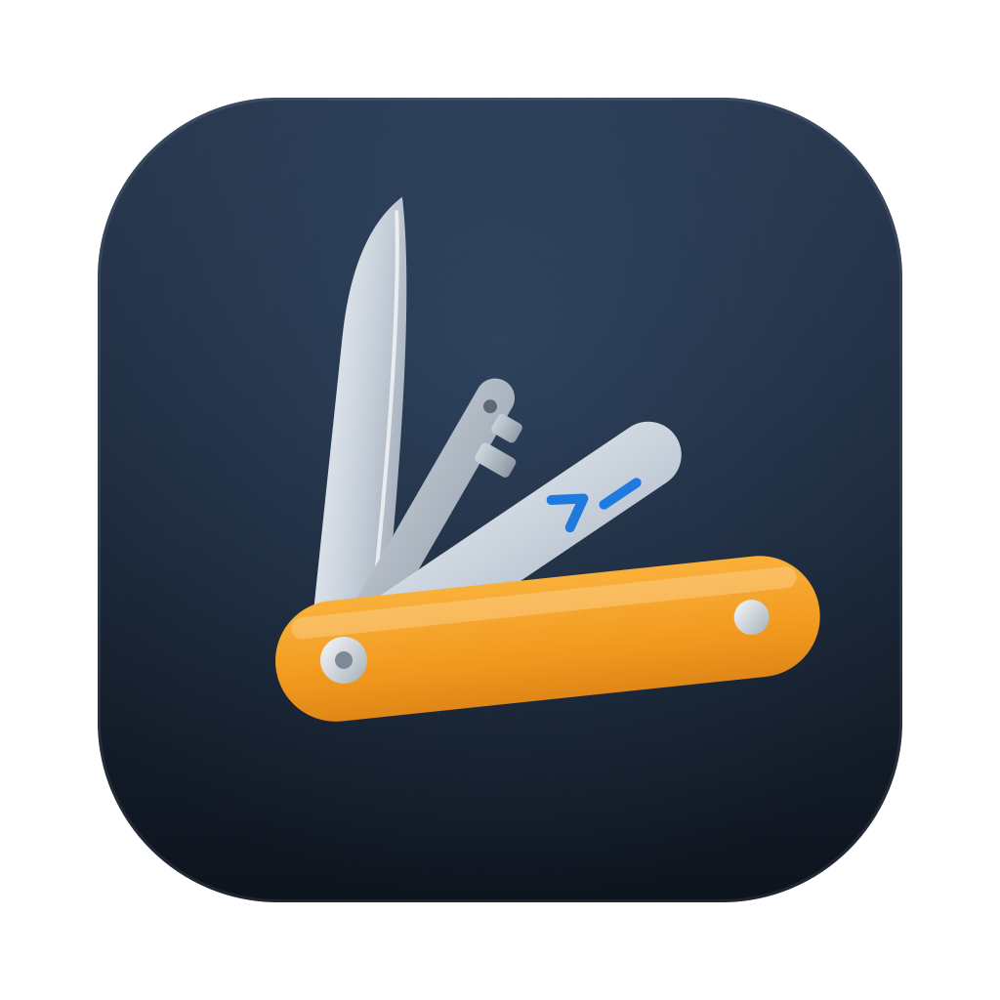

# Pocketknife

A native macOS app for the things a developer keeps reaching for: **shell commands** you can't quite remember, **logins**, and small **text utilities** (JSON, XML, Base64, JWT). Built with SwiftUI and SwiftData. Everything stays on your Mac.

- **CLI Commands**: save command templates with parameters, fill them in, and copy the result.
- **Passwords**: usernames and websites in the app's database, with the passwords themselves in the macOS Keychain.
- **Utilities**: format or minify JSON and XML, encode or decode Base64, and decode JWTs.

---

## Requirements

| | |
|---|---|
| macOS | 15.0 (Sequoia) or later |
| Xcode | 16 or later |
| Swift | 6.0 (strict concurrency) |
| Dependencies | None. Only Apple frameworks: SwiftUI, SwiftData, AppKit, Security, Synchronization |

## Getting started

```bash
git clone <repo-url> cli-db
cd cli-db
open CliDB.xcodeproj
```

In Xcode, pick the **CliDB** scheme and press **⌘R**. Press **⌘U** to run the tests.

From the command line:

```bash
# Build
xcodebuild -project CliDB.xcodeproj -scheme CliDB -configuration Debug build

# Test
xcodebuild -project CliDB.xcodeproj -scheme CliDB test
```

The first time you open **CLI Commands** with an empty library, the app adds a few sample commands to show how templates work.

---

## Features

### Home

The main window opens on a home screen with three cards, one per section, each showing how many items it holds. Click a card or press **⌘1 / ⌘2 / ⌘3**. Press **⌘0**, or the Home button in the toolbar, to go back.

### 1. CLI Commands

A three-column library: sidebar → command list → detail.

- **Sidebar**: *All Commands*, *Favorites*, and one entry per tag, with counts.
- **Search**: every word you type has to appear somewhere in the title, template, notes or tags.
- **Sort**: Recently Used (default), Most Used, Name, or Date Added. Your choice is remembered.
- **Detail pane**: a form for each parameter, a live preview of the finished command with highlighting, a warning for required parameters that are still empty, *Reset to Defaults*, and usage stats ("Used 4 times · Last used yesterday").
- **Copy** (⌘↩ in the detail pane, ⇧⌘C from the menu) puts the finished command on the clipboard and counts it as a use.
- **Editor**: opens in its own window (⌘N to create, ⌘E to edit) and has:
  - a template field with an **Insert Parameter** helper and a live preview,
  - a warning when a `{{` is never closed,
  - tags, with autocomplete from tags you already use,
  - **Parameter Values**, a saved list of values to pick from for each parameter,
  - notes and a Favorite toggle,
  - a prompt before throwing away unsaved changes.
- Smart quotes and dashes that macOS inserts (`“ ” ‘ ’ — –`) are turned back into plain ASCII when you save, so they can't break a shell command.

#### Template syntax

Placeholders go inside double curly braces:

| Syntax | Meaning | Example |
|---|---|---|
| `{{name}}` | Required value | `docker exec -it {{container}} sh` |
| `{{name:default}}` | Value with a default | `lsof -ti :{{port:3000}}` |
| `{{name\|a,b,c}}` | Pick from a list (the first item is the default) | `git checkout -b {{type\|feature,fix,chore}}/{{name}}` |
| `{{name:b\|a,b,c}}` | Pick from a list, with a chosen default | `/bin/{{shell:bash\|bash,sh,zsh}}` |

Rules:

- A parameter used more than once is filled once and the value goes into every place it appears.
- Spaces around names, defaults and choices are trimmed.
- Anything that isn't a valid placeholder (for example `{{{x}}}` or `{{ }}`) is left as plain text.
- When a value is empty, the preview shows `<name>` and the copied command uses the default.
- Values you save in the editor appear alongside the inline `|a,b,c` choices. You can also save the value you're typing from the detail pane.

### 2. Passwords

A searchable list of saved logins, with favorites sorted to the top.

- **Fields**: title, username, website, notes, password.
- **The password is stored only in the macOS Keychain** (service `<bundle id>.passwords`), keyed by a UUID kept on the record. It is never written to the SwiftData database. Deleting a login removes its Keychain item too.
- **Copy Password** (⌘↩) marks the clipboard entry as *concealed* (`org.nspasteboard.ConcealedType`) so clipboard managers skip it, and **clears the clipboard after 60 seconds** unless you've copied something else since then.
- Show or hide the password, open the website (`https://` is added when you leave out the scheme), and copy the username.
- **Password generator**: 20 characters with at least one letter, one digit and one symbol. Characters that look alike (`0 O 1 l I`) are never used.

### 3. Utilities

A split view with one tool per sidebar entry. Each tool remembers its own input.

| Tool | Modes | Notes |
|---|---|---|
| **JSON** | Format / Minify | Changes only the whitespace. Key order and number formatting stay exactly as you wrote them. Parse errors show the reason. |
| **XML** | Format / Minify | Never loads external entities or DTDs. An `<?xml …?>` declaration appears in the output only if your input had one. |
| **Base64** | Encode / Decode | A *URL-safe* option for encoding (`-` and `_`, no padding). Decoding accepts both alphabets and ignores whitespace and missing padding. |
| **JWT** | Decode | Accepts a `Bearer ` prefix. Shows the header and payload as formatted JSON, plus `iat` / `nbf` / `exp` as UTC dates marked expired or valid. The signature is shown but **not verified**. |

Shared controls: Paste, Clear, Find in the input and output, **Use as Input** to chain transforms, **Copy Output**, and **Expand**, which opens the output in a large window that can go full screen.

---

## Keyboard shortcuts

| Shortcut | Action |
|---|---|
| ⌘0 / ⌘1 / ⌘2 / ⌘3 | Home / CLI Commands / Passwords / Utilities |
| ⌘N | New command (or new password in the Passwords section) |
| ⌘↩ | Copy the selected command or password; in an editor, save |
| ⇧⌘C | Copy the selected command to the clipboard |
| ⌘E | Edit the selected command |
| ⌘D | Duplicate the selected command |
| ⇧⌘F | Add the command to Favorites or remove it |
| ⌘⌫ | Delete the selected command (asks first) |
| ⌘F | Find in a utility's input or output |
| ⌃⌘F | Full screen for the expanded output window |
| Esc | Cancel an editor |

---

## Architecture

```
CliDB/
├── CliDBApp.swift              # `PocketknifeApp`: App entry: scenes, shared ModelContainer, menu commands
├── Commands/
│   └── CommandMenu.swift       # Menu bar (New, Go, Command) wired through FocusedValues
├── Models/
│   ├── SavedCommand.swift      # @Model command + ResolvedCommand (values, preview, missing)
│   └── SavedPassword.swift     # @Model login (secret in Keychain) + PasswordGenerator
├── Services/
│   ├── TemplateParser.swift    # {{placeholder}} scanner, renderer, parse cache
│   ├── TextTransforms.swift    # JSON / XML / Base64 / JWT, pure functions
│   ├── Keychain.swift          # Thin wrapper over SecItem* APIs
│   ├── Clipboard.swift         # Plain and concealed, auto-clearing copies
│   └── SampleData.swift        # Sample commands added on first launch
└── Views/
    ├── ContentView.swift       # Section switching + Home toolbar button
    ├── HomeView.swift          # Home screen cards
    ├── Commands/               # Three-column command library
    ├── Detail/                 # Command detail + parameter form
    ├── Editor/                 # Command editor window, tag field, parameter values
    ├── Passwords/              # Password list, detail, editor
    ├── Utils/                  # Utilities + expanded output window
    └── Components/             # Chip, FlowLayout, Toast, CodeTextView, HighlightedCommand
CliDBTests/                     # Unit tests (Swift Testing)
```

### Windows

`PocketknifeApp` (in `CliDBApp.swift`) declares three scenes that all share **one `ModelContainer`**, so a change made in one window shows up in the others right away:

1. **Main window** (`Window "Pocketknife"`): home screen and the three sections.
2. **Command editor** (`WindowGroup` keyed by `EditorTarget`): one window per command being created or edited.
3. **Output** (`WindowGroup` keyed by `ExpandedOutput`): the large view of a utility's output.

The editor and output windows are not restored on relaunch.

### Data

- **SwiftData** stores `SavedCommand` and `SavedPassword` in the app's sandboxed container.
- `SavedCommand` keeps the template, tags, notes, favorite flag, use count and last-used date, the values you last entered (`lastValues`), and the saved values for each parameter (`parameterValues`).
- `SavedPassword` keeps everything except the password, which is read and written through the `Keychain` service by `keychainID`.
- Small UI preferences (sort order, whether samples were added) live in `@AppStorage`.

### Menus

The menu bar can't see the main window's state directly. Instead, each section publishes **focused values** (`commandActions`, `newPasswordAction`, `sectionNavigation`), and `CommandMenuCommands` reads them. This is how ⌘N creates a password when you're in Passwords and a command everywhere else, and how menu items are disabled when nothing is selected.

### Template engine

`TemplateParser` is a hand-written scanner (faster than `Regex` for this grammar). It turns a template into `[TemplateSegment]`, a list of `.text` and `.placeholder` pieces, and keeps parsed templates in a thread-safe `Mutex` cache of up to 512 entries, because views ask for the same templates on every redraw. `ResolvedCommand` works out each parameter's value, the rendered command, the `<name>` preview and the list of missing parameters in a single pass.

### Security

- Passwords live only in the Keychain, never in SwiftData.
- Password copies are concealed from clipboard managers and cleared after 60 seconds.
- The XML parser never fetches external entities.
- JWT signatures are shown but never verified. Don't rely on this tool to decide whether a token can be trusted.
- The App Sandbox is enabled.

---

## Tests

`CliDBTests/` uses **Swift Testing** (`@Test`) and covers the logic that doesn't depend on the UI:

| File | Covers |
|---|---|
| `TemplateParserTests.swift` | Placeholder syntax, defaults, choices, repeated parameters, invalid braces, rendering, punctuation cleanup |
| `SavedCommandTests.swift` | Tag persistence and normalization, parameter values merged with inline choices |
| `SavedPasswordTests.swift` | Website URL handling, search, password generator rules |
| `TextTransformsTests.swift` | JSON and XML format/minify and invalid input, Base64 round trips and invalid input, JWT decoding and invalid tokens |

Run them with **⌘U** in Xcode or `xcodebuild … test` (see [Getting started](#getting-started)).

---

## Project info

- Bundle ID: `com.miy33t.CliDB`
- The app was renamed from CliDB to **Pocketknife**. The Xcode project, target, scheme, source folders and bundle ID keep the old name on purpose: the bundle ID locates the Keychain items and the SwiftData store, so changing it would orphan existing data.
- Version: 0.1.0
